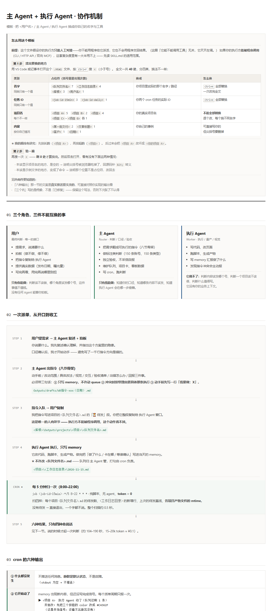

# super-agent-brief-writing


**这是一个 Agent skill 包**，记录「执行方只能人工对接时，主 Agent 怎么管住它」这套分工方法。
它解决的是那种「每一步都得你亲自盯」的窘境。

**★ 先把「API」这个词说清楚，不然后面会读歪：**

```
这里说的不是「Agent 能不能调用工具」—— 它当然能，而且每天都在调。
说的是【对接方向】的两头都断：
　　你 → 它　不能用程序派活（没有 CLI、没有 HTTP 端点、没有双向 MCP）
　　它 → 你　不能用程序交回结果（不会推事件、不会返结构化返回值）
所以只能复制粘贴。这套方法就是为那种情况写的。
```

**读完大概 4 分钟。如果你只想知道结论：把验收从脑子里搬到一个每 5 分钟跑一次的脚本里，
并且接受「执行方会自己把队列打了勾」这个坑。**

**目录**　[30 秒判断](#30-秒判断你该不该往下读) ·
[解决什么问题](#它解决什么问题) ·
[快速开始](#快速开始) ·
[前置条件](#前置条件) ·
[已知限制](#已知限制) ·
[最值钱的是「坑」](#最值钱的不是流程是坑)

---

## 30 秒判断：你该不该往下读

| 你的情况 | 建议 |
|---|---|
| 执行方**不能被程序调用**（没有 CLI / HTTP 端点 / 双向 MCP），只能复制粘贴 | **往下读** |
| 执行方**能被程序调用**（CLI / HTTP API / 双向 MCP） | 关掉 —— 这套里有一大半是负资产 |
| 想找一个开箱即用的工具 | 关掉 —— 这不是工具，是一份方法记录 |
| 想看清「人肉接口」怎么做到不失控 | 从 [它解决什么问题](#它解决什么问题) 读起 |

---

## 它解决什么问题

你在用两个 Agent：一个负责判断（主 Agent）一个负责干活（执行 Agent）。
但执行方不能被程序调用，于是：

```
派单 → 复制粘贴 → 等 → 回来问「做完了吗」→ 自己核 → 出下一批
```

这条链上每一步都得你亲自盯。于是出现三种典型故障：

| 故障 | 表现 |
|---|---|
| **失明** | 执行方做完了，你不知道；或者卡住了，你也不知道 |
| **假完成** | 它说「自检通过」，你一核发现有东西没做 |
| **空转** | 你自己连改五轮，用户一次都没真用过 |

这套方法把这三件事分别用「心跳 + 自动打勾」「独立验收判断」「迭代节奏纪律」解掉。

---

## 长什么样



九节：三个角色 / 一次派单的五个步骤 / cron 的六种输出 / 判断为什么只给三段 /
数据在哪 / 「完成」怎么判 / 成本 / 三个坑 / 这套东西在解决什么。

可直接打开 `templates/mechanism-diagram.html`（单文件、零外链、占位符可替换）。
★ 那份文件顶部有「怎么用这个模板」—— 三步换完占位符就能用，40 处全列在表格里。

---

## 快速开始

### 1. 拿到它

```bash
git clone https://github.com/Lawcakfen/super-agent-brief-writing.git
```

### 2. 两种用法

**A. 作为 Agent 的 skill（推荐）**

```bash
cp -r super-agent-brief-writing ~/.hermes/skills/
```

放好之后，对 Agent 说「给 X 写一个执行指令」，它就会加载这份 skill。

> 其他兼容 `SKILL.md` 的框架（Claude Code / Cline 等）：拷到它读 skill 的目录即可。
> 保持目录名不变 —— 改了 Agent 会找不到它。

**B. 当文档读**

`SKILL.md` 本身就是一篇可以顺着读的长文，从 §0.0 适用范围开始。

### 3. 只想先看看值不值

**读 `references/brief-skeleton.md`（5 页）。** 五条铁律 + 八节骨架 + 三类产物 ——
那是写指令的核心，不需要装任何东西，也不需要 Agent。

### 4. 想让脚本跑起来（自动盯梢 + 自动验收）

**`scripts/` 里是能直接用的代码，不用自己写。**

```bash
cd super-agent-brief-writing/scripts

# ① 复制配置模板
copy agent-config.example.json agent-config.json        # Mac/Linux: cp

# ② 打开 agent-config.json，填 projects_root
#    —— 你的项目根目录，它下面每个子文件夹是一个项目
#    hermes_home 可以留空，会自动探测

# ③ 自检：看到「项目根可用  是」就配好了
python paths.py
```

**配好之后：**

```bash
python wb_watch.py --init     # 建监听基线（只需一次）
python wb_watch.py            # 手动跑一次，静默就是正常
```

**然后把它挂到定时任务上**（每 5 分钟一次，8:00–22:00）。

**★★ 第一次跑之前，先读 `scripts/paths.py` 开头的注释** ——
它解释了这个文件为什么存在：原来 5 个脚本里有 10 处写死的绝对路径，
换台机器就跑不起来。

> **看到什么算正常：**
> `paths.py` 全绿 → `--init` 打印「基线已建」→ 正常跑一次什么都不输出（静默）。
> **静默不是故障，是默认状态。**

---

## 核心概念：只有三件事

```
① 把「判断」和「执行」切开，中间用一份书面指令连接
② 队列（待发 / 已完成 / 卡在外部）是唯一的派单状态源
③ 验收不在你脑子里，在一个每 5 分钟跑一次的脚本里
```

**★★ 最贵的一条经验，是「执行方会自己把队列打了勾」** —— 它把队列当任务清单，做完顺手打勾，
于是监听脚本永远看不到「待发」，自动验收一次都没跑过。
**我误判了两天才发现。**（详见 `references/automation.md`）

---

## 前置条件

这套东西分三层，每层的门槛差很多。大多数人只需要前两层。

### 第 0 层：只读方法（零前置）

读 `references/brief-skeleton.md`。不需要装任何东西，不需要 Agent。

### 第 1 层：让 Agent 帮你写指令（1 个前置）

```
一个能加载 SKILL.md 的 Agent（Hermes / Claude Code / Cline / 任何读 SKILL.md 的框架）
```

拷到它的 skills 目录，说「给 X 写个执行指令」就会加载。
**这层就够了 —— 至于要不要上自动验收，随你。**

### 第 2 层：跑自动盯梢 + 自动验收（5 个工具前置 + 4 个约定 + 4 个习惯）

#### A. 工具（缺一条就跑不起来）

| # | 前置 | 为什么必须 |
|---|---|---|
| 1 | 一个**不能被程序调用**的执行 Agent | 能程序化调用就该用回调，这套是负资产 |
| 2 | 一个**定时任务机制**（cron / Windows 任务计划 / systemd timer） | 心跳和验收全靠「每 5 分钟跑一次」 |
| 3 | **Python 3** + `scripts/` 里的代码 | 队列解析 / 扫描 / 触发。**代码已经写好了，不用自己写** —— 只要配 `agent-config.json` 里的两个路径 |
| 4 | **Agent 的一次性调用入口** | judge 要起一个独立 session。Hermes 是 `hermes -z "..."`；你的 Agent 得有等价的 —— 没有它，判断起不来，只能退化成「只报完成不给判断」 |
| 5 | **LLM API 额度** | 每次判断 15–20k token |

#### B. 目录约定（这套东西的骨架，要自己建）

```
<项目根>/
└── <项目 A>/
    ├── <队列文件>.md          ← 必须四段：⏳ 待发 / ✅ 已完成 / ⏸ 等外部 / 📌 口径备忘
    └── <工作日志目录>/        ← 执行 Agent 每次做完往这写，你读它
```

| # | 约定 | 不建的后果 |
|---|---|---|
| 6 | 每个项目一个目录 | 扫描器没法区分派单归属 |
| 7 | **队列四段，不是两段** | 「等外部」和「等执行方」混在一起 → 心跳天天误报「派单 4 小时没动」 |
| 8 | 执行方的日志目录，且你能读 | 没有日志 = 没有完成信号来源，自动验收直接失效 |
| 9 | 一个基线缓存文件 | 分不清「本次新增」和「全量重读」→ 每次扫描重复报同一条 |

#### C. 习惯（最容易被忽略，但决定成败）

| # | 习惯 | 不做会怎样 |
|---|---|---|
| 10 | 愿意写 **8–10KB 的长指令** | 短指令它就会自己补全，编得很顺但没真发生 |
| 11 | 验收**不采信自报** | 它说「自检通过」，你照着回「通过」→ 确认了一个没验证的结论 |
| 12 | 接受「人肉粘贴」省不掉 | 这不是缺陷，是设计前提。想省掉就该换**能程序调用**的方案 |
| 13 | 执行方**只写日志、不许动队列** | 它会顺手打勾，然后监听器永远看不到「待发」 |

#### D. 最硬的一条，没法用工具解决

> **你得知道「做完」长什么样。**

如果交付物做完是什么样你自己都说不清，验收脚本会变成一台制造假安全感的机器 ——
它会给你三段判断、给你「该核这几点」，但你说不出「核到什么程度算过」，于是只能看它说得像不像。

这套里所有判据（完成信号、重合阈值、4 小时卡住），都建立在「你心里有一个明确的完成标准」之上。

### 成本和时间

```
扫描　　　　  token = 0，每次 0.5 秒
一次判断　　  15–20k token ≈ ¥0.1，耗时 100–190 秒
一天 3–5 次　 约 ¥0.4/天 ≈ ¥12/月

写一份指令　  20–30 分钟（八节骨架，8–10KB）
一轮迭代　　  1–2 小时（派单 + 等 + 验收 + 下一批）
```

一天只派一次单的话，这套自动化的收益很薄 —— 人工看一眼更快。
它值钱的场景是「一天多批、你不想盯着」。

### 建议的最小验证路径（别一上来装全套）

```
第 1 天　只读 references/brief-skeleton.md，手写一份指令 → 看比平时好用多少
第 2 天　拷 skill 进 Agent，让它帮你写指令 → 省 20 分钟
第 3 天　建队列四段 + 日志目录（手写，不自动）
第 4 天　上扫描脚本（只做「完成时报警」，不做判断）
第 5 天　上判断（judge）
```

每一步都能单独用，也都能停在原地。全套一起上，你会在第三天遇到「为什么它一直误报」然后放弃。

---

## 文件结构

```
SKILL.md                           402 行　主文件（触发 + 硬规矩 + 常见坑）
references/
  ├── acceptance-standards.md          **开项目第一件事：分阶段验收标准库**
  ├── acceptance.md                    验收五动作 + 三类「全过了但用户用不了」
  ├── auto-acceptance-judge.md         judge 的完整实现（prompt 全文 / 锁 / 成本）
  ├── automation.md                    心跳 / 队列分段 / 外部改队列检测 / 语义缺口 / **产物监控**
  ├── brief-skeleton.md                五条铁律 + 八节骨架 + 三类产物 + **七轮实测配比**
  ├── flow-diagram.md                  把这套机制画成图
  ├── intake-triage.md                 **接一批改造需求时怎么归因分批**
  ├── publishing-status.md             发布进度（内部账本，可删）
  └── refactor-existing.md             改造已有代码（最长的一份）
templates/
  ├── gift-webpage-brief.md            单文件礼物页的指令骨架
  ├── instruction.md                   指令模板：**必带的三句话** + 八节骨架
  └── mechanism-diagram.html           机制可视化单文件（顶部有「怎么用这个模板」）
scripts/
  ├── agent-config.example.json        配置模板，复制成 agent-config.json 再改
  ├── judge.py                         起一次独立 session 做三段判断
  ├── paths.py                         **所有路径的唯一来源**（换设备只改 agent-config.json）
  ├── project_watch.py                 每日全量汇报的数据采集（可选）
  ├── queue.py                         队列解析 / 匹配完成信号 / 打勾
  └── wb_watch.py                      **主循环**：扫日志 + 扫产物 + 心跳 + 打勾 + 触发判断
docs/preview.png                   预览图
```

---

## 已知限制

```
① ★★★ 完整链路在作者本机只跑通 1 次。
   之前它失明了整整两天（原因见「核心概念」第三条）。
   所以：把它当【踩坑记录】读，不是当【生产级方案】抄。

② 不含实现代码。
   references 里讲的是机制和 prompt，没有随包发布可跑的脚本。
   你需要自己实现三个东西：队列解析器 / 心跳扫描器 / 判断触发器。
   三份加起来约 400 行 Python，references/auto-acceptance-judge.md 里有完整 prompt。

③ 只适用于「执行方只能人工对接」的环境。
   每 5 分钟轮询、人肉粘贴、让执行方写日志当汇报 ——
   这三样在人工对接时是唯一可行解，在能程序调用时全是负资产。

④ 成本：每次自动判断 15–20k token（约 ¥0.1）。
   扫描本身 token=0。一天 3–5 次交付约 ¥0.4。

⑤ 它假设你交付的东西值得验收 ——
   如果你自己都不知道「做完」长什么样，验收脚本会变成一台制造假安全感的机器。
```

---

## 最值钱的不是流程，是「坑」

`SKILL.md` 的「常见坑」表有 30+ 条，全部来自实测。举三条：

```
· 用 bash heredoc 写含转义的 Python → \n 被吃成真换行，同一会话踩两次
· 日期相关的逻辑用今天验收 → 今天全绿，明天它自己坏（跨周那一刻）
· 相对时间词写进标题 → 「下周排期 · 11-16 ~ 11-22」，跨周就自相矛盾
```

每条都写了「代价」，不写「已优化」—— 因为不写代价，下次踩的时候你不认得它。

---

## 反馈

用下来发现问题，欢迎开 [Issue](https://github.com/Lawcakfen/super-agent-brief-writing/issues)。

**★ 特别欢迎这类反馈：「我按你说的做了，但在第 X 步卡住了」—— 那比「写得不错」有用一百倍。**

---

## License

MIT —— 见 [LICENSE](LICENSE)。

**拿走用可以，但请保留「这套东西在什么环境里会变成负资产」那段说明。**
